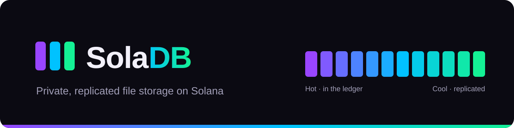

<p align="center">
  
</p>

# SolaDB

> **SolaDB** is private, replicated file storage built on [Solana](https://solana.com).
> Files are compressed and encrypted in the user's browser and kept by
> replicator nodes that get paid for every copy they confirm. Solana holds the
> commitments, the payments and who may read each file. Files are stored as
> **blobs** by default: Reed-Solomon shards spread over the nodes, one Solana
> account per blob however large it is, storage prepaid per epoch and checked
> with on-chain storage proofs. Small files can also go straight to the nodes
> as chunks (**direct**) or through the Solana ledger in 4 KiB transactions
> (**ledger**). While data waits for its replicas it is **Hot**; once enough
> nodes hold it, it is **Cool**.

| Component | Purpose |
| --- | --- |
| `programs/soladb` | Anchor 1.2 program `SoLA2LWHLmxARYxNKqtUaKMyttMwZ7WwnSHEgf47vu2`. Three modules in one program: **identity** (the X25519 key others seal data to), **storage** (chunks, segments, replication and its economics) and **records** (sealed file manifests and per-reader grants). |
| `soladb-node` | NestJS replicator: receives blob shards and direct chunks over HTTP, rebuilds missing shards from the other nodes, rebuilds ledger chunks from their transactions; checks everything against the on-chain hashes, stores it (filesystem, RocksDB or S3/MinIO/R2/B2, metadata in Postgres, Oracle or a file), confirms on-chain, answers storage challenges and claims its rewards, serves data over HTTP. |
| `sdk/` (`@soladb/sdk`) | TypeScript SDK and `soladb` CLI on `@solana/kit` 8: wallet-derived keys, gzip + end-to-end encryption, Reed-Solomon erasure coding and Merkle proofs, blob / direct / ledger uploads, bundles of small files, verified downloads, share, revoke, extend, reclaim rent. |
| `app/` | Browser demo with Wallet Standard (Phantom, Solflare, Backpack…) plus a test-only burner wallet. |

## Deployments

The program address is fixed (`SoLA2LWHLmxARYxNKqtUaKMyttMwZ7WwnSHEgf47vu2`, vanity keypair kept out of git in `.keys/`).

| Cluster | Status | Details |
| --- | --- | --- |
| Devnet | Not deployed yet (the 431 KB program locks ~2.2 SOL of rent; the upload needs ~4.4 SOL for a moment, half comes back) | `deployments/solana-devnet.json` after `npm run deploy:devnet` |
| Mainnet | Not deployed | `npm run deploy:mainnet` |

## How it works

```
 Browser / CLI (SDK)
  │  1. derive X25519 key from a wallet message signature → register_identity
  │  2. gzip (when it saves ≥ 10 %), encrypt (AES-256-GCM, random key), split into chunks
  │  3. ONE wallet batch:  open_chunk × N (pays fee) + create_record (sealed manifest)
  │  4a. direct (default): PUT /chunk/:address/data to up to `replicas` nodes   ── 8 MiB chunks, 0 transactions
  │  4b. ledger:           session key writes write_segment(index, bytes) × M   ── v1 txs, 3 864 bytes each
  ▼
soladb program ── Chunk PDA: sha256, (segment bitmap), escrowed rewards
  │                               │
  │  fee: 10% treasury,           ▼
  │  90% escrowed per replica   Replicator nodes (soladb-node)
  │                               │  direct: bytes pushed by the uploader, or copied from a peer node
  │                               │  ledger: getProgramAccounts(needs_replicas) + getTransaction → segments
  │                               │  verify sha256 against the chunk, store (RocksDB + Oracle)
  │                               ▼
  │  confirm_replication × K ─ one tx; each reward moves from its chunk escrow to the node
  ◄──────────────────────────────┘
  │  ≥ 60 % of replicas confirmed → Cool
  │  last replica confirmed → the chunk account closes, its rent goes back to the uploader
  ▼
 Reader: Record (or Grant) → open sealed manifest → GET /chunk/:address/data → verify + decrypt + gunzip
         (ledger chunk and no replicator yet? the SDK rebuilds it from the ledger)
 Share:  grant_access(record, viewer, manifest sealed to the viewer's key)
 Done:   delete_record / revoke_access refund the rent of their accounts
```

### Blobs: erasure-coded storage for large volumes

Specified in [docs/blob-protocol.md](docs/blob-protocol.md). A blob turns a payload into `k + m` shards with Reed-Solomon over GF(2^8): any `k` shards rebuild it, so it survives `m` lost nodes while storing only `(k + m) / k` times its size. The SDK picks the code from the nodes available (10+4 with 14 nodes, 4+2 with 6, 2+1 with 3).

- **One account per blob.** `open_blob` stores a single Merkle root over the shard roots (leaves = 1 KiB segments). 1 TB is about 100 accounts, not ~119 000 chunk accounts and ~20 000 wallet signatures.
- **Shards go straight to the nodes**, one per node, in resumable 8 MiB `PUT`s. Each node checks its shard against the root the uploader paid for, then takes its slot with `confirm_shard`. Readers fetch fragments with their Merkle proof (`X-SolaDB-Proof`), verify each one and decode from any `k` shards.
- **Storage is prepaid per epoch** (`price_per_mib_epoch`, default 200 lamports per MiB of shard per 30 days) and escrowed in the blob. A holder's rewards unlock only up to its last **storage proof**: anyone can `create_challenge`, the segment to answer is picked by the hash of a slot that does not exist yet (SlotHashes sysvar), and the holder must send that 1 KiB segment with its Merkle path in `prove_shard` within `challenge_window_slots`. Nodes challenge themselves before claiming.
- **Lost shards are repaired.** A holder that lets a challenge expire loses its slot and unclaimed rewards (`fail_challenge`, with a bounty for the reporter); any other node then rebuilds that shard from `k` others, fragment by fragment, and takes the slot.
- **Bundles** pack many small files into one blob and one record (`uploadFiles`), so thousands of small files do not mean thousands of accounts.
- Owners `extend_blob` before expiry; one epoch after expiry `close_blob` returns the rent and any unspent escrow.

| 1 TB of data | Chunks (direct, 2 copies) | Blobs (10+4) |
| --- | --- | --- |
| Accounts / wallet transactions | ~119 000 / ~20 000 | ~100 / ~17 (blobs of up to 10 GiB, files of up to ~200 GB) |
| Bytes stored on nodes | 2 TB, survives 1 lost copy | 1.4 TB, survives 4 lost nodes |
| Holders accountable | Paid once at confirmation | Paid per epoch against storage proofs |

### Direct and ledger chunks

- A chunk's bytes never live in account state. The `Chunk` account keeps only the commitment (sha256), the layout, the replicas that confirmed and the escrowed rewards.
- **Direct** (`segment_size = 0`, up to 16 MiB): the chunk is `Hot` as soon as it is opened. The uploader sends the bytes to replicator nodes over HTTP; a node only stores bytes that hash to a chunk somebody paid for, so it cannot be spammed for free. Nodes that were not sent the chunk copy it from a node that has it. There is no ledger copy: if no node took the chunk, the uploader closes it after 10 minutes and gets everything but the fee back.
- **Ledger** (up to 1 MiB): each `write_segment` carries one slice in its **instruction data**, so the ledger holds the chunk while it is **Hot**. The program accepts each segment index once, so every replicator rebuilds exactly the same bytes, and the last write flips the chunk from `Pending` to `Hot`. Readers can rebuild it from the ledger before any node has it. It costs one 5 000-lamport transaction per 3 864 bytes.
- Once `replication_threshold_pct` (60 %) of the requested replicas confirm, the chunk is **Cool**. Confirmations stay open until every requested replica exists; the last one closes the account and refunds its rent to the uploader.

### Economics

Each chunk costs `replicas × (base_fee_per_replica + ⌈size × price_per_mib / MiB⌉)` lamports, paid in `open_chunk` (with a `max_fee` guard):

- `protocol_fee_bps` (default 10 %) goes straight to the treasury.
- The rest is escrowed **inside the chunk account**, one reward per requested replica. `confirm_replication` moves the reward to the replicator in the same transaction (no withdraw step, no pull payments). Nodes confirm up to 8 chunks per transaction.
- The last confirmation closes the chunk and refunds its rent: the uploader never has to claim it. After `replication_window` (default 7 days) the uploader can `reclaim_unreplicated` the rewards of unfilled slots, or `close_chunk` to get the escrow **and** the rent back. A `Pending` upload can be aborted at any time, a direct chunk nobody confirmed after 10 minutes.
- Record and grant accounts lock rent that comes back on `delete_record` / `revoke_access`.

Default pricing (`scripts/init.ts`): 10 000 lamports per replica per chunk (covers the node's confirmation) + 20 000 lamports per MiB per replica, pro rata (≈ 0.02 SOL per GiB per replica).

What a file costs at mainnet prices (2 replicas, default pricing, rent 5 080 lamports/byte, SOL at USD 108.08 on 12 Oct 2026). *Real cost* is what the uploader spends; *deposit* comes back once the chunks are replicated; *kept* is the record's rent, back when the file is deleted:

| File | Before (v1 ledger, per-byte pricing): real cost | Ledger now: real cost | Direct now: real cost | Direct: deposit (seconds) | Direct: kept |
| --- | --- | --- | --- | --- | --- |
| 100 KB | USD 0.063 | USD 0.018 | USD 0.004 | USD 0.20 | USD 0.24 |
| 1 MB | USD 0.59 | USD 0.15 | USD 0.007 | USD 0.20 | USD 0.24 |
| 10 MB | USD 5.90 | USD 1.53 | USD 0.047 | USD 0.39 | USD 0.26 |
| 100 MB | USD 58.95 | USD 15.30 | USD 0.44 | USD 2.35 | USD 0.43 |
| 1 GB | USD 589.46 | USD 152.91 | USD 4.40 | USD 23.65 | USD 0.24 |

Ledger uploads cannot go below ~1.3 lamports per byte (one 5 000-lamport signature per 3 864 bytes, about USD 150 per GB), which is why direct is the default. Text, JSON or CSV files also shrink 3–10× with gzip before they are priced.

Measured on a local validator (`npm run measure-costs`, 2 replicas, default pricing, incompressible data, fully replicated by two test replicators; rent at the local 6 960 lamports/byte):

| File | Mode | Chunks | Segment txs | Upload fee | Network fees | Held during upload | Kept (record rent) | Real cost | Time |
| --- | --- | --- | --- | --- | --- | --- | --- | --- | --- |
| 100 KiB | direct | 1 | 0 | 0.000024 SOL | 0.000005 SOL | 0.005520 SOL | 0.003014 SOL | 0.000029 SOL | 0.6 s |
| 100 KiB | ledger | 1 | 27 | 0.000024 SOL | 0.000145 SOL | 0.005688 SOL | 0.003014 SOL | 0.000169 SOL | 1.7 s |
| 1 MiB | direct | 1 | 0 | 0.000060 SOL | 0.000005 SOL | 0.005563 SOL | 0.003021 SOL | 0.000065 SOL | 0.6 s |
| 1 MiB | ledger | 4 | 272 | 0.000120 SOL | 0.001375 SOL | 0.015345 SOL | 0.003689 SOL | 0.001495 SOL | 4.2 s |
| 10 MiB | direct | 2 | 0 | 0.000440 SOL | 0.000005 SOL | 0.008651 SOL | 0.003250 SOL | 0.000445 SOL | 0.9 s |
| 10 MiB | ledger | 41 | 2 721 | 0.001220 SOL | 0.013645 SOL | 0.121993 SOL | 0.003028 SOL | 0.014865 SOL | 27.2 s |

| Instruction | Compute units |
| --- | --- |
| `register_identity` | 11 458 |
| `open_chunk` (direct) + `create_record` | 48 885 |
| `open_chunk` (ledger) + `create_record` | 48 436 |
| `write_segment` (v1, 3 864 bytes) | 7 622 |
| `confirm_replication` | 16 001 |
| `confirm_replication` (last replica, closes the chunk) | 15 459 |
| `open_blob` | 27 434 |

Blobs, measured on the same validator (`open_blob` with default pricing, 12 epochs of 30 days prepaid, rent at the local 6 960 lamports/byte); the shards themselves cost no transaction:

| File | Erasure code | Stored on nodes | Storage fee (~1 year) | Network fees | Blob rent (back at expiry) |
| --- | --- | --- | --- | --- | --- |
| 1 MiB | 2+1 | 1.5 MiB | 0.000034 SOL | 0.000005 SOL | 0.003271 SOL |
| 1 MiB | 10+4 | 1.4 MiB | 0.000143 SOL | 0.000005 SOL | 0.008784 SOL |
| 100 MiB | 2+1 | 153 MiB | 0.000397 SOL | 0.000005 SOL | 0.003271 SOL |
| 100 MiB | 10+4 | 147 MiB | 0.000493 SOL | 0.000005 SOL | 0.008784 SOL |
| 1 GiB | 2+1 | 1 539 MiB | 0.003724 SOL | 0.000005 SOL | 0.003271 SOL |
| 1 GiB | 10+4 | 1 442 MiB | 0.003601 SOL | 0.000005 SOL | 0.008784 SOL |

At USD 108 per SOL a year of 1 GiB on 10+4 costs about USD 0.39 (the price is a config value); the deposit dominates for small files, which is what bundles are for.

The program is built with `opt-level = "z"`: about 15 % smaller than `opt-level = 3` (431 KB with blobs; deploy rent is paid per byte) for about twice the compute units, which cost nothing without a priority fee.

### Privacy model

- Chunks are AES-256-GCM ciphertext under a random per-file key. The ledger is public and permanent, so encryption is the protection.
- The file key and chunk list (the manifest, a compact binary format) are sealed with X25519 + HKDF-SHA256 + AES-256-GCM to the owner's key and stored in a `Record` account. Each reader gets their own sealed copy in a `Grant` account.
- The X25519 key comes from the wallet's ed25519 signature of a fixed message (deterministic, RFC 8032), so there are no extra secrets to store. Only sign that message inside SolaDB apps.

## Solana specifics

| Topic | How SolaDB handles it |
| --- | --- |
| Direct uploads | Up to 16 MiB per chunk, no transactions besides the wallet batch. Nodes accept `PUT /chunk/:address/data` only for a direct chunk that needs replicas, whose size and sha256 match the account, so storing junk costs the sender the upload fee. |
| Transaction size | Ledger segment writes use **v1 transactions** (SIMD-0296/0385, 4 096 bytes, live on mainnet since 15 Sep 2026): 3 864 data bytes per tx versus 1 010 with v0. `segmentTxVersion: 0` falls back for RPCs that do not accept v1 yet. v1 messages carry an explicit compute-unit limit and loaded-accounts-data limit. |
| Wallet prompts | The wallet signs **one batch per upload** (open + pay every chunk, create the record, and for ledger uploads fund a session key). A throwaway session key, set as the chunk `writer`, signs the segment transactions locally and returns its leftover lamports at the end. The CLI writes with its own keypair. |
| Finding work | Replicators query `getProgramAccounts` with a memcmp on `needs_replicas` (offset 105): the chunk accounts are the work queue, no log cursor to persist. |
| Reading the bytes | Direct chunks: from the nodes (`GET /chunk/:address/data`), which also copy them from each other. Ledger chunks: `getSignaturesForAddress(chunk)` + `getTransaction(maxSupportedTransactionVersion: 1)`, decoding `write_segment` instruction data (top level and CPI). The SDK uses the same path as a fallback when no replicator has a chunk yet. Ledger history depends on the RPC: use one with full history (or rely on replicators) for old Hot chunks. |
| History window | Segments are read from transaction history, which RPC nodes prune (the local test validator after ~10 000 shreds unless started with a larger `--limit-ledger-size`, as `scripts/localnet.sh` does). Replicators must copy a chunk while it is Hot; after that only replicators (and history-keeping RPCs) have it. A node backs off from chunks whose history is gone instead of retrying them in a loop. |
| Reorg safety | Replicators read at `finalized` commitment by default (a chunk turns Cool ~14 s after upload on a local validator). |
| Rent | Chunk, record and grant accounts are sized exactly and refund their rent when closed; a chunk closes itself on its last confirmation. Amounts come from `getMinimumBalanceForRentExemption`, so the ongoing rent reductions (SIMD-0437) apply automatically. |
| Duplicate accounts (Anchor 1.0) | The treasury is marked `dup`, so an uploader can also be the treasury. |
| Initialization | Only the program **upgrade authority** can create the config (checked against ProgramData), so nobody can front-run `initialize`. |
| sBPF | Built as sBPF v3 (Anchor 1.2 default). |

## Getting started

Prerequisites: Rust, [Agave CLI](https://docs.anza.xyz/cli/install) ≥ 4.3 (v1 transactions on the local validator need ≥ 4.2), Anchor 1.2.1 (`avm install 1.2.1`), Node.js ≥ 22. On Windows use WSL for the Rust/Solana part.

```sh
npm install                 # sdk + app workspaces (+ tsx for scripts)
anchor build                # program → target/deploy/soladb.so, target/idl/soladb.json
cargo test -p soladb        # 40 program tests on LiteSVM
npm run build:sdk
```

### Local rehearsal (everything on your machine)

```sh
npm run localnet            # terminal 1: solana-test-validator with the program; admin = .localnet/admin.json
npm run init:localnet       # config + pricing → deployments/solana-localnet.json
npm run test:sdk            # 42 SDK unit tests + 16 end-to-end tests against the validator (chunks, blobs, proofs)
npm run measure-costs       # compute units and cost per file size
```

Then run a node against it (see below) and `NODE_URL=http://localhost:3000 npm run e2e:localnet`. The node has its own end-to-end checks: `npx tsx soladb-node/test/e2e-localnet.ts` (chunks, one node) and `npx tsx soladb-node/test/e2e-blobs.ts` (blobs on four nodes: upload, a lost node, storage proofs and claims, a failed challenge, repair, bundles).

### Deploy and configure

```sh
cp .env.example .env        # DEPLOYER_KEYPAIR, REPLICATOR_KEYPAIR, REPLICATOR_ENDPOINT, pricing
npm run deploy:devnet       # solana program deploy (vanity id) → init.ts → export-idl.ts
npm run fund-replicator:devnet
```

`init.ts` is idempotent: it creates the config, updates it when the pricing variables change, registers replicators and writes `deployments/solana-<cluster>.json`. `export-idl.ts` copies the IDL into the SDK and regenerates `sdk/src/deployments.ts`.

### Run a replicator node

With Docker: the node stores chunks and shards in MinIO (S3) and metadata in Postgres; Oracle is still available with `--profile oracle`.

```sh
cp soladb-node/.env.example soladb-node/.env   # SOLANA_RPC_URL, NODE_ENDPOINT, …
docker compose up -d --build                     # node + minio + postgres (dev passwords: override them)
```

Storage backends (`soladb-node/.env.example` lists every variable):

| What | Options |
| --- | --- |
| Chunks (`CHUNK_STORE`) | `s3` (AWS S3, Cloudflare R2, Backblaze B2, MinIO: `S3_BUCKET`, `S3_ENDPOINT`, …), `rocksdb`, `fs` |
| Blob shards (`BLOB_STORE`) | `s3` (multipart uploads, range reads; staging on local disk) or `fs`; RocksDB is not meant for GiB objects |
| Metadata (`METADATA_STORE`) | `postgres` (`DATABASE_URL`, `PG_SCHEMA`), `oracle`, `file` |

Blob maintenance: `BLOB_POLL_INTERVAL_MS`, `BLOB_REPAIR` (rebuild vacant slots), `BLOB_CHALLENGE_OTHERS` (challenge other holders for the bounty), `BLOB_CLAIM_MIN_LAMPORTS` (prove and claim once this much accrued).

The replicator keypair is mounted from `./.keys/devnet-replicator.json` (override with `REPLICATOR_KEYPAIR_FILE`).

Without Docker (file-based stores, for development). On Linux with a recent glibc (Ubuntu 24.04 and later) the `rocksdb` dependency neither loads its prebuilt binary nor compiles, so use Docker, Windows, macOS or Debian bookworm there:

```sh
npm run build:sdk
cd soladb-node && npm install && npm run build
CHUNK_STORE=fs METADATA_STORE=file REPLICATOR_KEYPAIR=../.keys/devnet-replicator.json npm run start:prod
```

The node exposes:

- `GET  /status`: cluster, program, replicator registration, balance, confirmations, earnings, last scan
- `POST /query`: JSON query language (filter, sort, paginate) over stored chunks
- `GET  /chunk/:address/meta`: chunk metadata (local, else on-chain)
- `GET  /chunk/:address/data`: raw (encrypted) chunk bytes; CORS enabled for browsers
- `PUT  /chunk/:address/data`: a direct chunk from its uploader (raw bytes, ≤ 16 MiB); stored and confirmed only if it matches the on-chain chunk
- `PUT  /blob/:blob/shard/:index?offset=N`: a piece of a blob shard (resumable; the first piece carries the shard roots and fragment size); verified against the on-chain root, then `confirm_shard`
- `GET  /blob/:blob/roots`, `GET /blob/:blob/info`: the shard roots and layout (verifiable against the on-chain root)
- `GET  /blob/:blob/shard/:index/fragment/:stripe`: one fragment, with its Merkle proof in `X-SolaDB-Proof`
- `GET  /blob/status`: shards held, pushes, rebuilds, proofs, claims, challenges
- `GET  /docs`: Swagger/OpenAPI UI

Replicator settings worth knowing: `MIN_REWARD_LAMPORTS` (skip cheap chunks), `SOLANA_COMMITMENT` (default `finalized`), `UPDATE_ENDPOINT_ON_START` (publish `NODE_ENDPOINT` on-chain).

### SDK

```ts
import { createSolanaRpc } from '@solana/kit';
import { SolaDBClient, DEPLOYMENTS } from '@soladb/sdk';

// signer: any Kit TransactionSigner (KeyPairSigner, a Wallet Standard account signer…)
const soladb = new SolaDBClient({ signer, signMessage, deployment: DEPLOYMENTS.devnet });
await soladb.register();                                         // one message signature + one tx
const quote = await soladb.quoteFile(bytes.length, 2);           // fee, network fees, chunk + record deposits
const { recordId } = await soladb.uploadFile(bytes, { name: 'video.mp4', epochs: 12 }); // blob when nodes answer
await soladb.uploadFile(bytes, { name: 'audit.pdf', mode: 'ledger' }); // through the Solana ledger instead
const bundle = await soladb.uploadFiles(invoices, { name: 'facturas-octubre' });  // N small files, 1 account
await soladb.downloadFile(bundle.recordId, { entry: 'factura-7.json' });
await soladb.extendFile(recordId, 12);                           // prepay 12 more epochs
await soladb.share(recordId, friendAddress);                     // friend must be registered
const { data } = await soladb.downloadFile(recordId);            // verified + decrypted
await soladb.reclaimAllDeposits();                               // aborted / unfilled chunks (replicated ones refund by themselves)
```

### CLI

```sh
npm run build:sdk
export SOLADB_CLUSTER=devnet SOLADB_KEYPAIR=~/.config/solana/id.json
node sdk/dist/cli.js register
node sdk/dist/cli.js quote ./video.mp4 --epochs 12                   # --mode blob|direct|ledger|auto
node sdk/dist/cli.js upload ./video.mp4 --epochs 12 --redundancy 4    # --mode ledger, --no-compress
node sdk/dist/cli.js upload-many facturas ./facturas/*.json           # one bundle, one account
node sdk/dist/cli.js bundle <recordId> -d ./restored
node sdk/dist/cli.js extend <recordId> 12
node sdk/dist/cli.js ls
node sdk/dist/cli.js share <recordId> <address>
node sdk/dist/cli.js download <recordId> -o copy.pdf
node sdk/dist/cli.js reclaim               # aborted or unfilled chunks you own
```

### Demo app

```sh
npm run app:dev        # http://localhost:5173, devnet by default
```

For a local validator set `VITE_SOLADB_CLUSTER=localnet` (see `app/.env.example`) and use the burner wallet (test only) with its airdrop button.

## Repository layout

```
programs/soladb/
  src/instructions/admin.rs       config, pricing, replicator registry
  src/instructions/identity.rs    X25519 encryption keys
  src/instructions/storage.rs     open_chunk, write_segment, confirm_replication, reclaim, close
  src/instructions/records.rs     sealed manifests, grants
  src/instructions/blobs.rs       open_blob, confirm_shard, challenges, prove_shard, claims, extend, close
  src/state.rs                    accounts (Config, Identity, Replicator, Chunk, Blob, Record, Grant), Merkle proofs
  tests/soladb.rs                 LiteSVM tests
idl/soladb.json                   Anchor IDL (source of the SDK codecs)
sdk/                              @soladb/sdk + soladb CLI: erasure.ts (Reed-Solomon), merkle.ts, blob-layout.ts, client.ts (+ tests)
app/                              browser demo (Vite)
soladb-node/                      NestJS replicator node: replicator/ (chunks), blobs/ (shards, proofs, repair), storage/ (fs, RocksDB, S3, Postgres, Oracle)
scripts/                          localnet, deploy, init, fund-replicator, e2e, measure-costs, export-idl
deployments/                      deployed addresses, e2e results, measured costs
docs/blob-protocol.md             the blob format and protocol (normative)
docker-compose.yml                replicator + MinIO + Postgres (Oracle profile)
```

After changing the program, run `anchor build` and `npm run export-idl`.

## Origins

SolaDB started as the Solana port of [AvaDB](https://github.com/Emanuel250YT/AvaDB), the same Hot/Cool design first built for Avalanche and then for Monad (EVM). What changed on the way to Solana:

| AvaDB on Monad (EVM) | SolaDB on Solana |
| --- | --- |
| 3 contracts (IdentityRegistry, AvaDBStorage, AvaDB) | 1 program, PDAs per identity / chunk / record / grant / replicator |
| Chunk bytes in event logs (48 KiB per tx) | Chunk bytes straight to the nodes (direct, default) or in `write_segment` instruction data (3 864 bytes per v1 tx) |
| `keccak256(data)` checked on-chain | sha256 committed at `open_chunk`, checked by replicators and readers |
| `eth_getLogs` poller + persisted cursor | `getProgramAccounts` work queue (stateless) |
| Pull payments (`withdrawRewards`) | Reward paid inside `confirm_replication` |
| Protocol fees accrue, `withdrawProtocolFees` | Protocol share transferred to the treasury in `open_chunk` |
| Storage costs gas forever | Accounts refund their rent when closed; chunks close themselves once replicated |
| Key from a secp256k1 signature | Key from an ed25519 message signature |

## License

[MIT](LICENSE)
